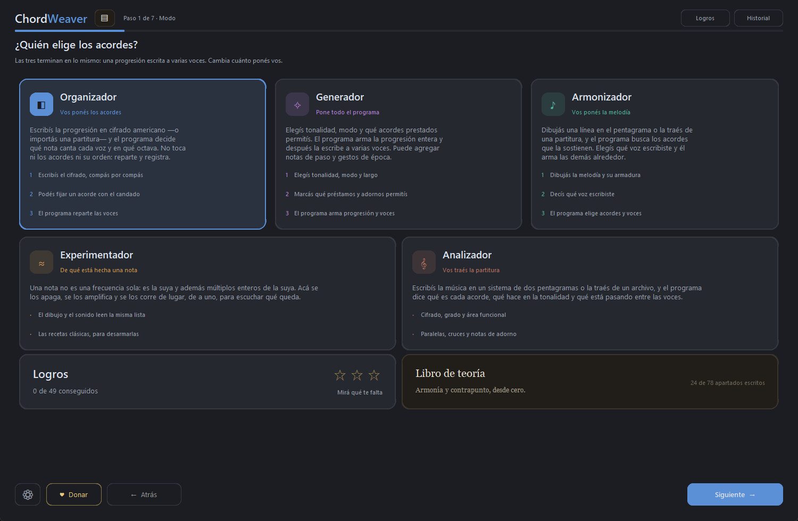
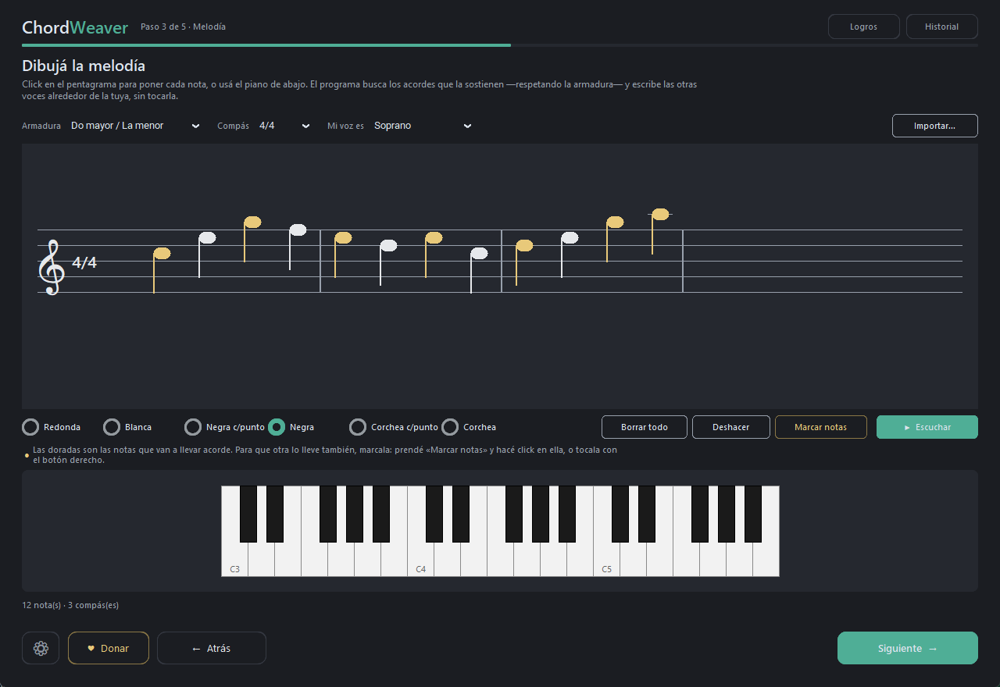
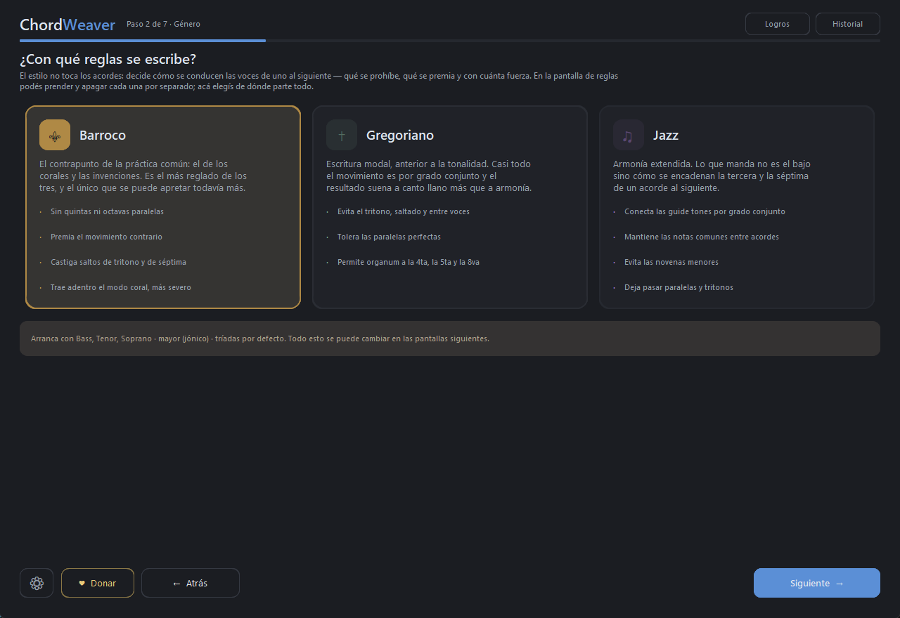
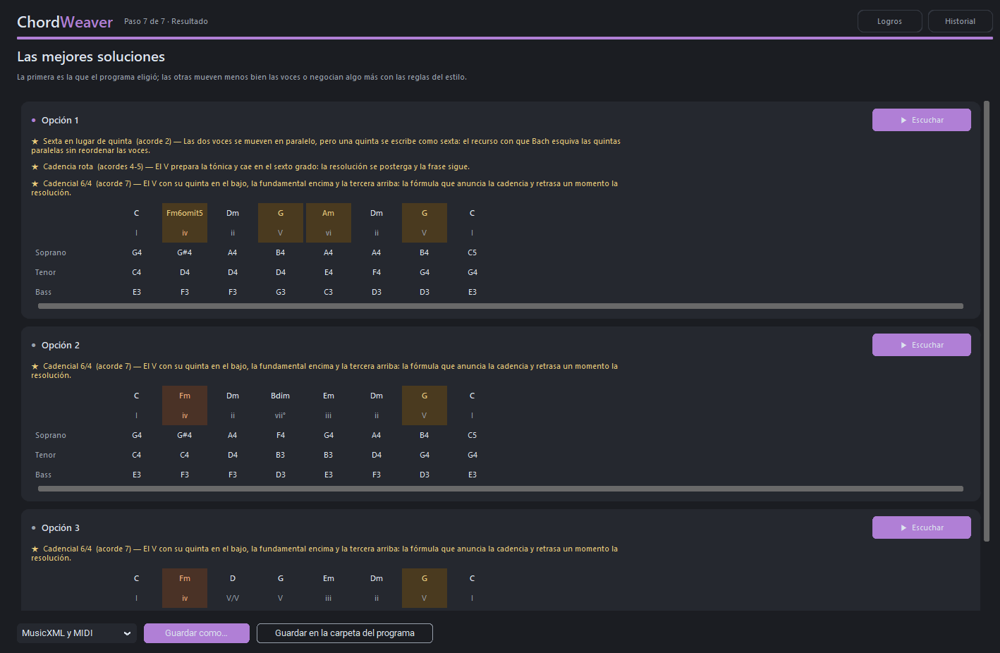
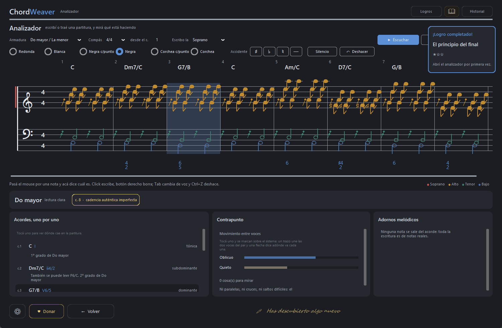
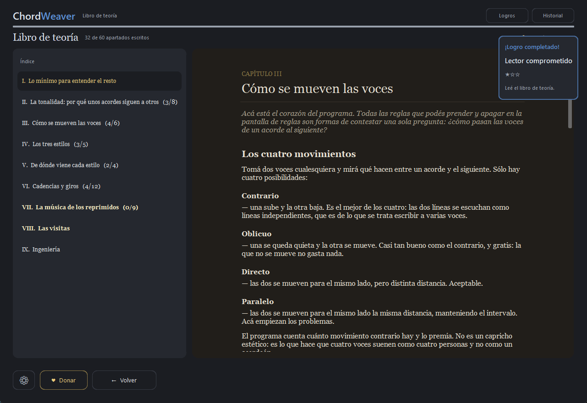
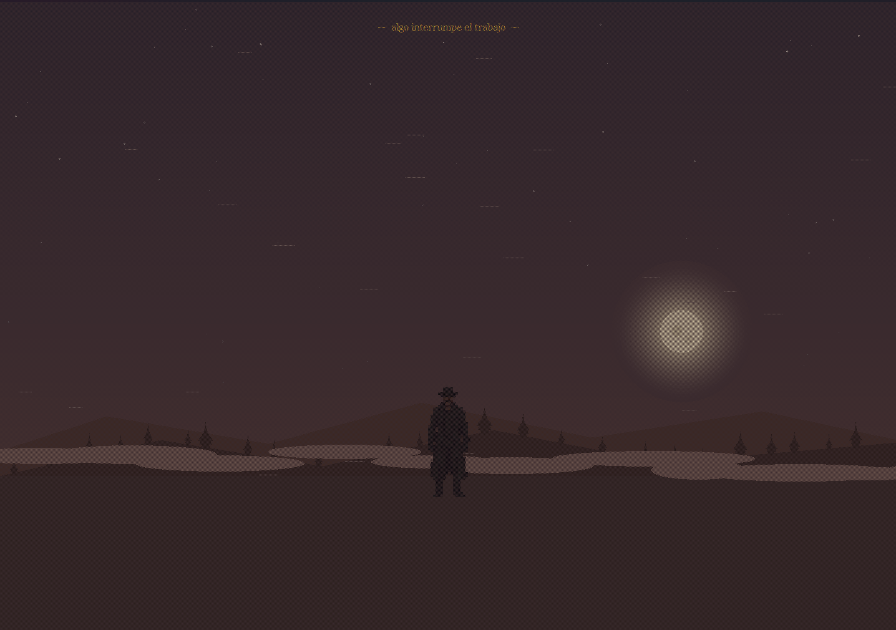

# ChordWeaver

**[chordweaver.github.io](https://chordweaver.github.io)** · [Download the latest version](https://github.com/ChordWeaver/chordweaver/releases/latest)

Your chords, your melody, or a blank sheet: a genetic algorithm turns any of the three into a multi-voice progression. It decides which chord note each voice sings and in which octave, minimizing overall voice movement without breaking the counterpoint rules of the selected genre.

The GA **never changes the chords or their order** — it only changes the register and distribution of the notes. In the Organizer, you write the chords yourself; in the Generator, the program creates them; in the Harmonizer, it finds them underneath the melody you drew.

And the other way around: the **Analyzer** takes an existing score — either written by hand or imported — and identifies what it is doing, chord by chord and step by step. The **Schoolhouse** uses that same Analyzer to mark writing exercises.



*The three modes. Each card shows what you put in, left of the arrow, and what the program writes. Below them, the three tools that don't compose anything.*

## Folder structure (IMPORTANT)

It must be structured exactly like this. If `engine/` is not a subfolder, Python will throw `No module named engine`:

```text
ChordWeaver/
├── app.py                 <- the GUI application
├── staff.py               <- the editable staff
├── analyzer.py            <- the analyzer screen
├── cinematic.py           <- story mode scenes
├── cli.py                 <- the same logic through the command line
├── tests.py
├── README.md
├── requirements.txt
├── ChordWeaver.spec
└── engine/
    ├── __init__.py
    ├── theory.py          <- notes, voices, chord notation parser
    ├── voicing.py         <- doublings and omissions
    ├── style.py           <- counterpoint rules by genre
    ├── fitness.py         <- hard constraints + penalties
    ├── ga.py              <- tournament, elitism, parallelism
    ├── export.py          <- MusicXML and MIDI
    ├── history.py         <- last 10 productions
    ├── book.py            <- the theory book text
    ├── achievements.py    <- catalog, stars and detectors
    ├── story.py           <- story mode: script and state
    ├── visitors.py        <- the visitors: who appears and when
    ├── ambience.py        <- manually synthesized sounds
    ├── harmonics.py       <- the harmonic series and its synthesis
    ├── analysis.py        <- reading an existing score
    └── session.py         <- facade
```

And next to `app.py` there are the four UI modules that aren't the main window:
`staff.py` (the editable staff, single and grand staff),
`spectrum.py` (the harmonic series experimenter), `analyzer.py` (the analyzer),
and `cinematic.py` (the scenes).

## Running it

The GUI application only needs one dependency:

```bash
pip install customtkinter
python app.py
```

The engine itself is pure Python (3.9+) and requires nothing else.
Stand in the `ChordWeaver/` directory and run:

```bash
python tests.py                                        # 384 tests
python cli.py --chords "Cmaj7 Am7 Dm7 G7 Cmaj7" --genre jazz
python cli.py --chords "C Am F G C F G C" --genre chorale
python cli.py --chords "Dm7 G7 Cmaj7" --time 3/4 --duration 1
```

Files are written to `output/`, next to the source code. Use `--out` to choose a different folder.

If you get `No module named engine`, it's almost always one of these two things:

1. You're standing in the wrong directory -> `cd` into the folder containing `cli.py`.
2. The engine `.py` files were left loose instead of being placed inside `engine/`.

## Using the interface

Seven screens in a carousel; you can always go back. The first one chooses the
working mode, which determines who provides the chords:

* **Organizer** — you write the progression (or import it) and the program
  only distributes the voices.
* **Harmonizer** — you draw the melody and the program finds the chords underneath it.
* **Generator** — the program creates the entire progression and then voices it.

Each mode has its own color, and that color tints the progress rail in the header
throughout the entire workflow.

Below the three modes are three more cards that don't lead to composition:
the **Harmonic Experimenter**, the **Analyzer** and the **Schoolhouse**. Below
those are the achievements and the theory book.



*The Harmonizer. The golden notes are the ones that will receive a chord, and they
are recalculated with every key press: it's the same calculation used by the search,
without choosing the chords yet. You can select any other note and that one will
receive its chord.*

The melody may leave the scale, and those notes are painted orange. One that
rises a semitone to the next note is its leading tone and gets that note's
dominant (V/x); in Baroque and jazz it sometimes gets its seventh degree
(vii°/x). In jazz, one that falls a semitone gets the tritone substitute. Any
other chromatic note is harmonized with a chord that contains it. A key
signature stands for a major key and its relative minor, and the last note
decides: a melody that ends on the relative minor is harmonized in minor.

The screens that follow:

1. **Genre** — determines which rules are applied and how they are weighted.
2. **Voices** — from 3 to 6 voices from the catalog (S, MS, A, T, Bar, B), with editable ranges.
3. **Measures** — base meter and number of measures; each measure can have a different meter.
4. **Chords** — American chord notation with live validation. If a chord has more
   notes than voices, it tells you which degrees are omitted. If it doesn't
   recognize the chord, the `piano` button opens a keyboard to choose the notes manually.
5. **Parameters** — all rule switches and GA parameters.
6. **Result** — the 3 best solutions, with format and output folder selection.



*The genre screen. The chorale mode isn't a card: it's a switch inside Baroque,
because it's the same counterpoint with stricter constraints.*



*The result. The three best solutions, each with what the program recognized inside
it — a deceptive cadence, a cadential 6/4, a sixth instead of a fifth — explained
in a single line. They can be played without leaving the screen.*

The `History` button in the top-right shows the last 10 productions.

## The Harmonic Experimenter

In the second row of the home screen, next to the analyzer, there's a door that
doesn't lead to composition. Inside is a single note, drawn as what it really is:
one bar for each harmonic, positioned by frequency and with its height representing
amplitude.

The graph doesn't illustrate the sound — **it is the sound**. Dragging a bar upward
amplifies that harmonic; dragging it sideways moves it away from its exact multiple
and detunes it against the others, which is how beats are produced. You can isolate
one and hear it by itself, mute it, return it to its exact position, change the note
from the keyboard, apply vibrato or tremolo to the entire set, and switch between
the eight classic recipes — sine, sawtooth, square, triangle, plucked string,
clarinet, organ, and voice — which aren't eight different ways of vibrating, but
the same series with different bar heights. With vibrato enabled, the bars are
drawn as stripes, like a bellows: the pitch is oscillating, and a solid bar is what
is drawn when it is stationary.

Below it, you can inspect the selected harmonic: its frequency, the closest
equal-tempered note, how many cents away it is, and its distance from the fundamental.
This makes it immediately obvious that the second harmonic is an octave, the third
is an octave and a fifth, the fifth falls fourteen cents below the piano's major
third, and the seventh falls thirty-one cents below the seventh.

`Save timbre...` takes the result outside the program. It doesn't export the sound:
the file contains the note it represents and the loop section marked inside it,
which is what makes any WAV sampler — TX16Wx, Kontakt, LMMS's AudioFileProcessor,
Live's Simpler, Polyphone for building a SoundFont — treat it as an instrument's
timbre: tuned across the entire keyboard and sustained for as long as the key is
held down. Making the loop seamless is the difficult part, so each component is
adjusted to the nearest multiple of the loop duration — down to a few hundredths
of a cent — and vibrato is written as phase modulation, which is the only thing
that makes it return to the same phase it started from.

Using it awards *Physics Graduate* and unlocks chapter **X** of the book.

## The Analyzer

The three modes write music. The Analyzer reads it: you give it a score — written
by hand on a grand staff or imported from a MusicXML file — and it answers the two
questions used when studying someone else's work.



*The first four measures of Bach's Prelude in C major, imported and analyzed:
I - ii4/2 - V6/5 - I, with figured bass notation underneath each chord.*

**What chord is happening at each moment, and what is it doing.** The key comes
from the key signature, the opening chord, and the resting chord, so it can be a
mode and not just major or minor. American chord notation appears above the staff
and figured bass below it, written in a column as it traditionally is; the scale
degree and functional area — tonic, subdominant, dominant — are shown in the list
on the left, where there is enough room to read them. A chord outside the scale is
explained: if it is a **secondary dominant**, it says which degree it targets and
whether it resolves; if it is a **modal interchange**, it says which mode it comes
from and what degree it represents there; and if several non-diatonic chords occur
in succession, they are read together — a tonicization, modulation, or chain of
dominants. Suspended fourths that subsequently resolve the fourth to the third are
identified as such.

Each note is written as it should be, rather than simply as whatever enharmonic
equivalent happens to fit: a flattened sixth degree is A♭, not the G♯ next to it,
and the fifth of a B7 is F♯ even if the piece is full of flats. When the file has no
key signature — as with the files exported by this program — it is inferred from
what is actually being played.

When two interpretations are equally good, both are offered: C-E-G-A is both
a C6 and an Am7, and there is nothing in those four notes that can decide between them.

**What the counterpoint is doing.** The movement between every pair of voices —
contrary, oblique, parallel, direct — is counted step by step, and **playable**:
when you select one, every pair of voices moving that way is highlighted on the
staff with a line connecting the two notes and an arrow on each showing where it
goes. Contrary motion can be recognized by seeing the two arrows pointing in opposite
directions.

Then parallel fifths and octaves, hidden fifths and octaves, voice crossings,
voice overlaps, and tritone leaps, each in its measure; plus melodic embellishments
— notes that don't belong to the chord — with their proper names: passing tone,
neighbor tone, appoggiatura, escape tone, suspension, anticipation, cambiata,
mordent, turn, pedal tone, and anacrusis. Each one says which measure and beat it
occurs on, and hovering over it shows what it is.

All cadences are named: perfect and imperfect authentic, plagal, deceptive,
half cadence, and Phrygian, plus the three named progressions that the generator
can identify — the four-chord Phrygian progression, the Vivaldi cycle, and the
descending chromatic bass. Each appears as a label with its measure, and clicking
it highlights the exact section where it occurs on the staff.

The counterpoint rules are not written twice: parallel fifths and octaves and
hidden fifths are checked by the same evaluator used by the genetic algorithm, so
the Analyzer cannot approve something the Generator forbids. They are judged by
the style chosen in the counterpoint panel: in Baroque and chorale writing a
parallel is a fault, in jazz and Gregorian it is noted without being flagged.
Two voices that move on different beats don't make parallels.

The staff holds four voices. A score with more is reduced moment by moment to
the lowest note, the highest, and the two inner notes that add the most to the
chord, so a piano piece is analyzed whole. Pickups and bars split across a
repeat are read correctly.

Measured against reference analyses of eight Bach chorales, it reads 87% of
the chords right and gets the key of all eleven pieces it was compared with.

## The Schoolhouse

Five units in order (voice motion, harmonies, cadences, styles and the
harmonic series) with 33 exercises. Each lesson explains a topic, quotes the
theory book entry that covers it and asks you to write, choose or listen. What
you write is marked by the Analyzer: when something is wrong it tells you in
which bar and which voices, without giving the answer away. A lesson opens once
the previous one is passed in full, and there is a graduation at the end.

### How to use it

Choose the key signature and meter as in the Harmonizer, choose which voice you are
writing and which note value you're using, and click where each note goes: its pitch
comes from where you click on the staff and **its timing comes from how high in the
measure you click**. If the voice hasn't reached that point yet, the gap is
automatically filled with rests; and if you click inside an already-written note,
that note is split and both ends remain what they were — exactly what you need to
insert a passing eighth note into the middle of a whole note without breaking
anything. No note can cross a bar line.

Right-click deletes the note underneath — leaving a rest so the voice doesn't shift
— while `Ctrl+Z` undoes the last change, whatever it was, and `Tab` moves to the
next voice without having to open the menu. Accidentals not included in the key
signature — sharp, flat, natural — are selected before writing the note.

To read the score, you don't have to click anything: hovering over any note shows
which note it is, which measure and beat it falls on, and what role it plays in its
chord.

The meter isn't necessarily the same for the entire piece: you choose the meter,
specify **from which measure** it applies, and from there the bar lines are drawn
accordingly. Choosing the same meter in a measure that already uses it removes that
change from the list.

Bass and tenor use the bass clef, while alto and soprano use the treble clef, just
like in the exported score. The number of voices isn't selected manually: it is
counted from what is written, and an imported score with more than four voices is
trimmed to the four lowest voices with a warning. A colored bar on the side shows
which clef is currently being written.

The Analyzer **doesn't say anything until three voices have been written**: a chord
is a triad, and naming chords from one or two notes would just be making them up.

`▶ Listen` plays whatever has been written, voice by voice and with its rhythm,
whether or not an analysis exists: with two voices there are no chords to name, but
there is still music to hear. `Export...` saves it as MusicXML and MIDI, including
its key signature, two clefs, and meter changes, just like the other three modes.
An analysis is not added to the history: the history stores engine runs, and this
isn't one.

`Import...` opens in `assets/partituras/`, where Bach's Prelude in C major is stored:
it's the piece used to tune the Analyzer and lets you test it without having to find
a file first. Everything exported by the Organizer, Generator, and Harmonizer can
also be imported here.

Opening it awards *The Beginning of the End*, and importing a score awards *I Came Prepared*.

## Timbres, Voices and Languages

From the gear menu you choose what everything the program plays sounds like:
several synthesized timbres, a joke one, or a WAV saved from the Harmonic
Experimenter. The voices screen has presets with singing and piano ranges. The
whole program is in Spanish and English; the language is chosen the first time
it opens and can be changed later from the gear menu.

## Tutorial and Theory Book

The first time the program is opened, it starts a guided tour that highlights
each mode and style directly on the actual interface, with the rest of the screen
dimmed. It can be skipped at any time, and can be viewed again from the gear icon
(`View the tutorial again`). When finished or skipped, it takes you to the
achievements screen and awards *Apprentice*.

The tour shows you where everything is. After that, there are three **screen
guides** that explain how to use the program, and they open automatically the
first time you reach the screen where each mode actually does its job:

| Mode       | Where        | What it explains                                                                                                      |
| ---------- | ------------ | --------------------------------------------------------------------------------------------------------------------- |
| Organizer  | chord screen | chord notation, durations and rests, making sure the meter closes exactly, the lock, and the piano                    |
| Harmonizer | staff screen | writing with clicks or the piano, note values, what the golden notes mean, the key signature, and which voice you are |
| Generator  | rules screen | what a hard rule is, the balance dial, consonance at resting points, and what happens when you generate               |

They can be skipped with a button, appear only once, and can all be shown again
together through the same `View the tutorial again` option in the gear menu.

Next to the achievements is the **theory book**: basic harmony, voice leading,
the three styles, the cadences recognized by the program — including the recipe
for making them appear — and an engineering chapter about the genetic algorithm.
It is written for people who have never studied music. Opening it awards
*Dedicated Reader*.



The book isn't written all at once: each section is tied to an achievement and
is written only when the user encounters that cadence, motion, or technique.
When that happens, the new section appears with a handwritten note at the bottom.

Two chapters unlock all at once rather than section by section: *Harmonizing a
Melody*, the first time the Harmonizer is used — it explains where each chord
goes and which interval the melody note usually belongs to, using the same
weights as the engine — and *Physics in Music*, the first time the Harmonic
Experimenter is used. The latter is the only chapter with scale-accurate
graphics: the harmonic series plotted by frequency and amplitude, the
subharmonic series, two timbres on the same note, and a zoomed-in view showing
that the seventh harmonic doesn't land on any piano key.

And there's a notification: for a few seconds, the same handwritten note appears
in the middle of the footer — *You've discovered something new* — and then
disappears on its own. What it's pointing you toward is the book, where the
chapter that received the new content is highlighted in blue in the index until
you read it.

## Story Mode

After five minutes of use — and only while the home screen is visible, the
tutorial is finished, and no search is running — a golden button appears on the
home screen. It doesn't tell you what it is. When you click it, a figure appears
and offers you a power, and your answer opens one of three paths:

| Answer | Path   | Companion              |
| ------ | ------ | ---------------------- |
| Accept | Blues  | the man in the hat     |
| Ignore | Jazz   | an anonymous guitarist |
| Reject | Gospel | Jesus                  |

Each path has three stages and always takes place in the same three locations:
a progression written by hand in the **Organizer**, a golden button in the
**Generator**, and a golden gesture in the **Harmonizer**. The two golden buttons
start locked: to unlock them, you have to repeat the stage's cadence in three
different keys and read the new section that the path added to the book.

The automatic stages don't go through the genetic algorithm or its parameters:
the piece — the twelve-bar blues, *All of Me*, the Gospel octave rule,
*Amazing Grace* — is written in advance and appears instantly. They also don't
award achievements: the program wrote the piece, not you. They do remain in the
history and can be exported like any other production.

Chapter **VIII** of the book, *The Music of the Repressed*, fills up with the
stages you complete instead of achievements. It tells where each thing came from:
the crossroads of the Mississippi Delta, the many kinds of *jazz*, the *spirituals*,
and the slave ship captain who wrote *Amazing Grace*.

At the end of each path, you receive its corresponding legendary achievement,
its title, and a memory, which remains next to the titles on the achievements
screen. There is also an **Repent** button there: it takes you back to the
crossroads and lets you choose again. Nothing you've earned is lost — achievements,
titles, and everything written in the book remain yours — and only the path itself
is reset.



*Something interrupts the work.*

All the sound in the scenes — the valley wind, birds, each character's voice,
the choir, the winds that close a piece — is synthesized by the program, just
like the audio from the `Listen` button. No sound files are packaged.

## Parallelism

The search uses multiple processes, not threads: it is pure CPU work in Python,
and the GIL would make threads take turns instead of running in parallel. The
number of workers is determined automatically according to the machine it is
running on (`workers=None`):

* leaves one core free so the window remains responsive,
* caps at 8 because beyond that, serialization costs more than the gain,
* and disables parallelism for small jobs, where the overhead costs more than it saves.

You can force a number with `GAConfig(workers=N)`.

## Genres

| Genre       | Parallel 5ths/8ves | Tritone   | Special voicings | Character                                      |
| ----------- | ------------------ | --------- | ---------------- | ---------------------------------------------- |
| `classical` | forbidden          | allowed   | yes              | favors contrary motion, small leaps            |
| `chorale`   | forbidden          | allowed   | yes              | like Classical, but stricter spacing and range |
| `gregorian` | allowed (organum)  | forbidden | no               | mostly stepwise motion                         |
| `jazz`      | allowed            | allowed   | yes              | closed voicings, preserves tensions            |

All switches can be enabled or disabled independently; the genre only defines
their initial values.

## Counterpoint Rules by Genre

In addition to minimizing movement, the fitness function weighs rules specific
to each tradition (see `engine/style.py`):

* **Classical / Chorale**: never double the leading tone; the seventh resolves
  downward and the leading tone upward; no voice overlap between adjacent chords;
  tritone and seventh leaps are penalized; a large leap is compensated by
  contrary motion; common tones and contrary motion against the bass are rewarded.
  Chorale applies all of this more strongly.
* **Gregorian**: mostly stepwise motion, narrow range, seconds and sevenths
  between voices are penalized, tritone forbidden by default.
* **Jazz**: rewards stepwise connection of guide tones (3rd and 7th), sevenths
  resolve downward, common tones are retained, and minor ninths (avoid notes)
  are avoided.

## Hard Rules vs. Penalties

**Hard rules** (invalidate the chromosome and never appear in the result):
vocal ranges, chord coverage, voice crossing, and whatever parallelism / tritone
rules you enable.

**Weighted rules** (the GA negotiates between them): total movement (the largest
weight), leap size, spacing, tessitura, static chord repetition, direct fifths,
and contrary motion.

## Compiling the Engine (Optional)

The three modules the search runs through millions of times per generation —
the evaluator, style rules, and note representation — can be compiled to C with
Cython:

```bash
pip install cython setuptools     # plus MSVC (Visual Studio Build Tools)
python build_engine.py            # leaves engine/*.pyd next to the .py files
python build_engine.py --clean    # removes them and returns to pure Python
```

**This is optional and does not change what the program does.** The `.py` files
are untouched: they are compiled as-is, with a separate type declaration sheet
(`engine/fitness.pxd`, `engine/style.pxd`) that Python ignores. If the `.pyd`
is next to the `.py`, Python automatically prefers it; if it isn't there, it
runs the `.py`. Without a compiler, the program works exactly the same, just
slower, and `pyinstaller ChordWeaver.spec` still produces a working executable.

Measured on 16 chords using the default search settings (200x300): the search
goes from 17.4 to 8.2 seconds in a single process and from 8.3 to 5.7 seconds
with all eight workers. The result is bit-for-bit identical — verified across
14 runs, four genres, three seeds each, plus the two generative modes.

## Packaging the .exe

```bash
pip install pyinstaller customtkinter
pyinstaller ChordWeaver.spec
```

The result is placed in `dist/ChordWeaver/` and is portable: copy it wherever
you want. It uses a folder-based build rather than `--onefile` on purpose,
because with onefile the program extracts itself into a temporary directory
and the history would no longer persist next to the executable.

## Counterpoint Audit (`python audit.py`)

The question it answers is: does each genre *actually* write according to its
tradition, or do they all converge on "the solution with the least movement"
with a different label?

The script runs several progressions with each genre and measures the result
against rules that the fitness function never sees as a single number, always
comparing against a control: the same search with all style weights disabled.

Measured results (average over 4 progressions × 2 seeds):

| metric                            | control | classical |  chorale | gregorian |     jazz |
| --------------------------------- | ------: | --------: | -------: | --------: | -------: |
| % stepwise motion                 |    86.5 |      79.2 |     79.0 |  **91.2** |     87.0 |
| % contrary motion                 |    11.3 |  **18.8** | **20.8** |      13.1 |     10.1 |
| parallel 5ths/8ves                |     1.5 |   **0.0** |  **0.0** |       1.4 |      2.0 |
| voice overlaps                    |     0.4 |   **0.0** |  **0.0** |       0.0 |      0.0 |
| % 7ths resolving downward         |    67.9 |  **85.7** | **96.4** |      67.9 |     78.6 |
| % guide tones moving stepwise     |    41.6 |      37.5 |     32.1 |      41.0 | **51.9** |
| average ambitus per voice         |     4.7 |       5.4 |      5.5 |   **3.8** |      5.3 |
| % perfect intervals over the bass |    36.5 |      40.1 |     36.5 |      39.6 |     39.1 |

Honest reading:

* **Classical and Chorale are clearly differentiated.** Contrary motion nearly
  doubles, and sevenths resolving downward increase from 68% to 86–96%. It's not
  placebo.
* **Jazz is moderately differentiated**: guide tones connect stepwise 52% of the
  time versus 42% for the control.
* **Gregorian is the weakest**, and there is a structural reason: its modal
  character lives mostly in the *harmony* (modal cadences, absence of a leading
  tone, open fifths), while in this app the user chooses the chords. The only
  thing the GA controls is note register and distribution. It still differs where
  its rules point: ambitus 3.8 versus 4.7, and more perfect intervals.
* Genres with strong rules **pay** movement for style (1.3 versus 1.2 semitones
  on average), which is exactly the trade-off the system is designed to make.

During the audit, it was discovered that the ambitus threshold was set to 9
semitones while the actual ranges are around 5, meaning the rule never activated.
It was corrected to 5.

## The Visitors

Apart from the path, there are six standalone appearances. They can't be chosen
and can't be skipped: they happen when they happen, and each leaves something
behind. The table lists the ones that can be triggered; the other two are described
below.

| Who              | When                                            | What it leaves                           |
| ---------------- | ----------------------------------------------- | ---------------------------------------- |
| Bach             | on the fifth Baroque score                      | chapter IX of the book                   |
| Bach, again      | the first time Chorale mode is used             | another section                          |
| Gregory I        | on the fifth Gregorian score                    | another section                          |
| Someone in black | after creating three sounds in the experimenter | another section, and *The Fourth Wall*   |
| A hooded entity  | after reaching 100% achievements                | the burned score and the Easter egg list |

The two masters congratulate and explain: Bach, that music was written in voices
rather than chords, and that this is what separates a chorale from everything
else; Gregory, organum — the *vox principalis* and its shadow at the fifth — which
is where everything the program does comes from. Both end with a genuine quote from
themselves.

The one in black is the only one who knows this is a program, and therefore the
only one who can tell both halves of the same story without changing the subject:
where the harmonic series comes from, and how you write that into a machine —
forty-four thousand one hundred numbers per second, sixteen bits each. You barely
see him: a silhouette backlit by his own screen.

The entity explains nothing. It says it has been watching, that it doesn't understand
how you got this far, and warns of someone who is coming. It leaves the fourth
object — a burned score whose author cannot be identified — and, at the bottom of
the achievements screen, the list of the six Easter eggs with the exact steps needed
to trigger them. It's the only part of the program that names them: until then,
the counter only tells you how many there are, never which ones.

The fifth appearance is **the vision**, and it is the only one that cannot be
triggered in any way. When opening the program, one time out of five — with the
tutorial already completed or skipped — and only once ever, you see a dirt road
at night, the full moon, and a train passing in the distance. Nobody speaks, and
the program doesn't either: it gives no message when the scene ends. Robert
Johnson's story is written in the book, in gold, as a legendary entry, and you
have to go find it.

And there is a sixth, which is the same night again. The same roll is made on
launches after the first one has already happened, and it also occurs only once.
It begins the same way — the same road, the same train, the same figure standing
in the middle — and ends differently: the screen suddenly goes black and comes
back with two figures. He is still facing forward in the same place; in front of
him, with their back turned and completely black, is someone who wasn't there
before. Then it goes black again, and the only thing said in either scene:
*“A wise decision…”*. When you continue, black again, and back to the menu. It
leaves another golden section in the same chapter, about the supposed pact and
what history did to this music over eighty years.

To watch them again, there are two ways. In the settings — the gear icon — there
is a **Watch Again** section with one button per appearance, and **only appearances
you have already experienced are shown**: listing all of them would reveal, by name
and condition, the six things the program hides. And from outside the program,
three environment variables:
`CHORDWEAVER_VISIT` forces a visit on startup (`watcher`, `bach_baroque`,
`bach_chorale`, `gregory`), `CHORDWEAVER_VISION=1` forces the vision, and
`CHORDWEAVER_PACT=1` forces the second scene.

Both methods play the entire scene and award whatever the scene normally awards,
so a scene watched from there will not appear again on its own.

## Importing a Score

There are three ways to bring music in from outside, and each reads the file
differently because each mode needs something different: the Organizer groups
notes that sound simultaneously and reads them as chords, the Harmonizer keeps
the highest note at each moment, and the Analyzer preserves **every voice
separately** — the only representation from which counterpoint can actually be
measured.

In chord-entry mode, the `Import score...` button reads a MusicXML file
(`.musicxml`, `.xml`, or compressed `.mxl`) and loads its chords with their rhythm
and measures. The order of the voices in the file is used as the starting point
and is what the lock proposes, but the program can rearrange it: that's what
importing is for. If you want to preserve the exact voicing as it came in, lock it.

## Contributing

The project's rules — what not to touch, what to run before a pull request, and
the five traps that fail silently — are in [`CONTRIBUTING.md`](CONTRIBUTING.md).
Before touching any musical logic, read [`MUSIC_LOGIC.md`](MUSIC_LOGIC.md).

## Status

* Version 1.2 ALPHA. 667 tests over the engine, the Analyzer, the Schoolhouse
  and export, plus `verify_ui.py` over the interface.

## License

[MIT](LICENSE).


